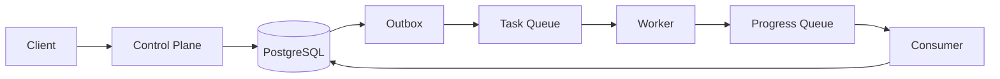

# tenant-provisioning
A multi-tenant provisioning service for automating tenant creation, configuration, resource allocation, and lifecycle management.

# Tenant Provisioning Control Plane

A backend service for managing tenant provisioning through asynchronous tasks using Go, PostgreSQL and RabbitMQ.

The project consists of a control plane that manages tenants and tasks, and a worker that simulates provisioning and reports progress.

## Tech Stack

- Go, Gin
- PostgreSQL, pgx
- RabbitMQ
- Docker Compose
- golang-migrate
- Go testing

## Architecture



The control plane handles HTTP requests, publishes tasks and consumes worker progress. The worker runs as a separate process.

## Setup

Requirements: Docker, Docker Compose v2, Make and OpenSSL.

Start the application:

```bash
make up
```

This generates local credentials, starts the database and broker, runs migrations and starts both services.

- API: http://localhost:8080
- RabbitMQ UI: http://localhost:15672

RabbitMQ credentials are available in the generated `.env` file.

Other commands:

```bash
make logs
make ps
make down
```

Data is preserved when the containers are stopped.

## API Endpoints

| Method | Endpoint | Status |
|---|---|---|
| POST | /api/v1/tenants | 201 |
| GET | /api/v1/tenants | 200 |
| GET | /api/v1/tenants/:id | 200 |
| PATCH | /api/v1/tenants/:id | 202 |
| DELETE | /api/v1/tenants/:id | 202 |
| GET | /api/v1/tasks | 200 |
| GET | /api/v1/tasks/:id | 200 |
| GET | /healthz | 200 |
| GET | /readyz | 200 / 503 |

### Create Tenant

```bash
curl -X POST http://localhost:8080/api/v1/tenants \
  -H "Content-Type: application/json" \
  -d '{"slug":"customer-one","name":"Customer One"}'
```

Returns the tenant and its deploy task. The tenant starts in `provisioning` state and becomes `active` after successful worker processing.

### Get and List Tenants

```bash
curl http://localhost:8080/api/v1/tenants/TENANT_ID

curl "http://localhost:8080/api/v1/tenants?limit=20&offset=0"
```

Both list endpoints support limit and offset pagination. The default limit is 20 and the maximum is 100. Records are sorted by creation time, newest first.

Replace `TENANT_ID` and `TASK_ID` with the actual IDs returned by the API.

### Update Tenant

```bash
curl -X PATCH http://localhost:8080/api/v1/tenants/TENANT_ID \
  -H "Content-Type: application/json" \
  -d '{"name":"Updated Customer","version":2}'
```

Only active tenants can be updated. The request must contain the current version and at least one editable field (`name` or `slug`).

### Delete Tenant

```bash
curl -X DELETE http://localhost:8080/api/v1/tenants/TENANT_ID
```

Only active or failed tenants can be destroyed. Destroyed tenants remain in the database and their slugs remain reserved.

### Track Tasks

```bash
curl http://localhost:8080/api/v1/tasks

curl http://localhost:8080/api/v1/tasks/TASK_ID
```

Tasks are read-only through the API.

## State Transitions

Tenant:

```text
provisioning -> active / failed
active       -> updating
updating     -> active / failed
active       -> destroying
failed       -> destroying
destroying   -> destroyed / failed
```

Task:

```text
accepted -> in_progress -> done / failed
```

Tenant versions are incremented on every tenant mutation, including terminal worker outcomes. Task progress alone does not change the tenant version.

## Error Responses

```json
{
  "error": {
    "code": "tenant_version_conflict",
    "message": "Tenant version does not match current version"
  }
}
```

| Error Code | Status |
|---|---|
| tenant_not_found | 404 |
| tenant_already_exists | 409 |
| tenant_update_not_allowed | 409 |
| tenant_version_conflict | 409 |
| task_not_found | 404 |
| invalid_request | 400 |
| invalid_slug | 400 |
| invalid_name | 400 |
| invalid_version | 400 |
| empty_tenant_update | 400 |
| invalid_pagination | 400 |
| route_not_found | 404 |
| method_not_allowed | 405 |
| internal_server_error | 500 |

## Messaging

The control plane and worker communicate through two RabbitMQ queues:

- `tenant.tasks` — provisioning tasks
- `tenant.progress` — worker progress updates

Each queue has a corresponding dead-letter queue.

Task event:

```json
{
  "id": "task-uuid",
  "tenant_id": "tenant-uuid",
  "type": "deploy",
  "status": "accepted"
}
```

Progress event:

```json
{
  "id": "task-uuid:done",
  "task_id": "task-uuid",
  "status": "done"
}
```

The task ID is also the outbound event ID. Progress events have stable IDs used for duplicate detection.

## Design Decisions

- Tenant, task and outbox records are saved in the same database transaction. Events are published only after commit.
- A transactional inbox handles duplicate progress events. Messages are acknowledged after database commit.
- Early terminal events are stored until the corresponding `in_progress` event arrives.
- Terminal tasks cannot be modified by later progress events.
- PostgreSQL unique constraints prevent duplicate tenant slugs.
- Row-level locking, version checks and tenant status guards prevent conflicting operations and multiple open tasks.
- Publisher confirmations, persistent messages and retry backoff are used for reliable messaging.
- The worker stores its selected outcome locally so retries do not produce conflicting results.

Message delivery is at-least-once. A single logical event may be delivered multiple times, so consumers must be idempotent.

## Failure Scenarios

### Worker Failure

```bash
WORKER_FAIL_RATE=1 docker compose up -d \
  --no-deps --force-recreate worker
```

Create a new tenant. The task and tenant should eventually become `failed`.

Restore normal processing:

```bash
WORKER_FAIL_RATE=0 docker compose up -d \
  --no-deps --force-recreate worker
```

### Slow Processing

```bash
WORKER_MIN_DELAY_MS=30000 \
WORKER_MAX_DELAY_MS=60000 \
docker compose up -d --no-deps --force-recreate worker
```

### RabbitMQ Failure

```bash
docker compose stop rabbitmq
```

Create a new tenant while RabbitMQ is unavailable. The event should remain pending in the outbox.

```bash
docker compose start rabbitmq
```

The dispatcher should retry publication and the worker should resume processing.

### Duplicate and Out-of-Order Messages

Stop the worker:

```bash
docker compose stop worker
```

Create a new tenant and copy its task ID.

The following commands require `curl` and `jq`:

```bash
. ./.env

TASK_ID="replace-with-task-uuid"

publish_progress() {
  payload=$(jq -cn \
    --arg id "$TASK_ID:$1" \
    --arg task "$TASK_ID" \
    --arg status "$1" \
    '{id:$id,task_id:$task,status:$status}')

  curl -fsS -u "$RABBITMQ_USER:$RABBITMQ_PASSWORD" \
    -H "Content-Type: application/json" \
    "http://localhost:${RABBITMQ_MANAGEMENT_PORT:-15672}/api/exchanges/%2F/amq.default/publish" \
    -d "$(jq -cn --arg p "$payload" \
      '{properties:{},routing_key:"tenant.progress",payload:$p,payload_encoding:"string"}')" |
    jq -e '.routed == true'
}

publish_progress done
publish_progress in_progress
publish_progress done
publish_progress in_progress
```

The early `done` event should remain pending until `in_progress` arrives. The remaining messages must not change the terminal state or increment the tenant version again.

Check the tenant and task endpoints between operations.

Restore the worker:

```bash
WORKER_FAIL_RATE=0 \
WORKER_MIN_DELAY_MS=1000 \
WORKER_MAX_DELAY_MS=5000 \
docker compose up -d --no-deps --force-recreate worker
```

## Testing

```bash
make test
```

Runs formatting checks, `go vet` and automated tests with isolated PostgreSQL and RabbitMQ containers.

Tests cover state transitions, database transactions, concurrent requests, messaging, idempotency, worker failures and publishing retries.

## Trade-offs

- The worker is designed for a single replica.
- Duplicate tasks may repeat the simulated processing delay.
- The outbox dispatcher uses polling and sequential publishing.
- Outbox and inbox records are retained without automatic cleanup.
- Early terminal events remain pending if `in_progress` never arrives.
- Readiness currently checks PostgreSQL only.
- Authentication and actual infrastructure provisioning are outside the project scope.